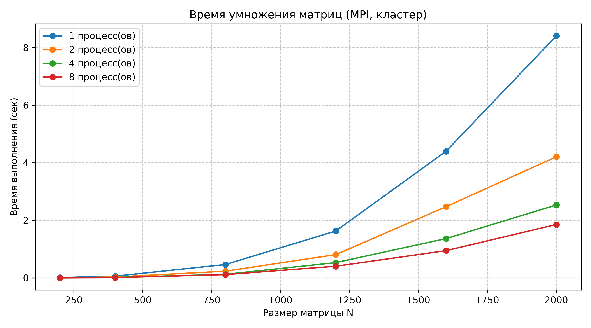
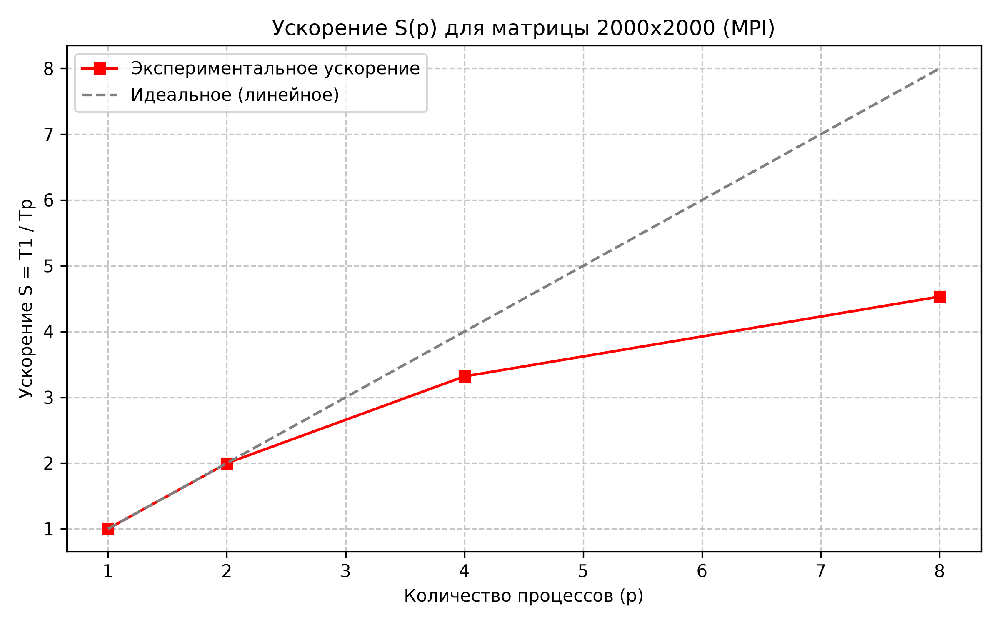

# Лабораторная работа №3: Параллельное умножение квадратных матриц с использованием MPI

## 1. Цель работы
Модификация алгоритма умножения матриц для распределенных вычислительных систем по стандарту MPI (Message Passing Interface). Исследование масштабируемости программы при запуске на различном числе процессов ($p \in [1, 2, 4, 8]$) и объемах данных ($N \in [200, 2000]$).

## 2. Аппаратное и программное обеспечение
* **Вычислительная среда:** Суперкомпьютер «Сергей Королёв» (Самарский университет), раздел `batch`.
* **Архитектура узла:** Блейд-сервер IBM BladeCenter HS23.
* **Процессоры:** 2 × Intel Xeon E5-2665 (8 ядер на процессор, базовая частота 2.40 GHz, 20 MB L3 Cache). Выделено 8 вычислительных ядер на задачу (`--ntasks-per-node=8`).
* **Оперативная память узла:** 32 ГБ.
* **Системный интерконнект:** QLogic 12800 InfiniBand QDR (пропускная способность 40 Гбит/с).
* **Операционная система:** CentOS 7.9 (x86_64).
* **Среда MPI:** Intel MPI 5.1.3 (`module load intel/mpi5`).
* **Компилятор:** GCC 4.8.5 (`mpicxx`), флаги оптимизации: `-std=c++11 -O3`.

## 3. Описание реализации
1. **Модель памяти:** Распределенная (Shared Nothing). Каждый процесс обладает изолированным адресным пространством.
2. **Схема декомпозиции:** Ленточная (горизонтальные полосы).
   * Процесс `0` считывает матрицы $A$ и $B$ из файлов.
   * Матрица $B$ рассылается целиком всем процессам через широковещательную рассылку `MPI_Bcast`.
   * Матрица $A$ делится на непрерывные блоки строк и распределяется с помощью векторной операции `MPI_Scatterv`.
3. **Вычисления:** Каждый процесс выполняет умножение полученной локальной полосы матриц по схеме $i-k-j$.
4. **Сбор результатов:** Результирующие строки матрицы $C$ агрегируются на процессе `0` коллективной операцией `MPI_Gatherv`.
5. **Замер времени:** Фиксируется интервал чистых параллельных вычислений без дискового ввода-вывода с использованием функции `MPI_Wtime()` и барьерной синхронизации `MPI_Barrier()`.

---

## 4. Результаты экспериментов

### Таблица 1. Время выполнения чистых вычислений $T(N, p)$ (сек)

| Размер (N) | 1 процесс ($T_1$) | 2 процесса ($T_2$) | 4 процесса ($T_4$) | 8 процессов ($T_8$) |
|:----------:|:-----------------:|:------------------:|:------------------:|:-------------------:|
|  **200**   | 0.0092            | 0.0038             | 0.0019             | 0.0010              |
|  **400**   | 0.0585            | 0.0294             | 0.0148             | 0.0074              |
|  **800**   | 0.4629            | 0.2314             | 0.1223             | 0.1133              |
| **1200**   | 1.6280            | 0.8065             | 0.5292             | 0.4032              |
| **1600**   | 4.3980            | 2.4714             | 1.3643             | 0.9448              |
| **2000**   | 8.4055            | 4.2076             | 2.5330             | 1.8547              |

---

### Таблица 2. Коэффициенты ускорения $S(p)$ и эффективности $E(p)$ для $N = 2000$

$$S(p) = \frac{T_1}{T_p}, \quad E(p) = \frac{S(p)}{p} \times 100\%$$

| Процессы ($p$) | Время $T_p$ (сек) | Ускорение $S(p)$ | Эффективность $E(p)$ |
|:--------------:|:-----------------:|:----------------:|:--------------------:|
| **1**          | 8.4055            | 1.00x            | 100.0%               |
| **2**          | 4.2076            | 2.00x            | 99.9%                |
| **4**          | 2.5330            | 3.32x            | 83.0%                |
| **8**          | 1.8547            | 4.53x            | 56.7%                |

---

## 5. Графики производительности

### Время выполнения

### Ускорение для матрицы 2000x2000

---

## 6. Верификация
Корректность алгоритма проверена на локальном компьютере с использованием скрипта `common/verify.py`. Поэлементное сравнение выходной матрицы с эталонным умножением NumPy (`np.matmul`) подтвердило совпадение с максимальной абсолютной погрешностью $< 10^{-5}$ (Статус: **OK**).

---

## 7. Выводы
1. **Масштабируемость:** На объеме задачи $N = 2000$ программа демонстрирует практически идеальное двукратное ускорение ($S = 2.00\times$, $E = 99.9\%$) при переходе с 1 на 2 процесса.
2. **Падение эффективности на 8 процессах:** При увеличении числа процессов до 8 ускорение составляет $4.53\times$ ($E = 56.7\%$). Снижение эффективности вызвано конкуренцией за пропускную способность общей шины памяти узла при одновременном чтении матрицы $B$, а также накладными расходами на рассылку данных (`MPI_Bcast`) и барьерную синхронизацию.
3. **Эффект кэш-памяти на малых матрицах:** На размерностях $N = 200$ и $N = 400$ зафиксировано сверхлинейное ускорение (до $9.47\times$ на 8 процессах), обусловленное тем, что локальные части полос матриц полностью помещаются в быстрый кэш L1/L2 процессора.