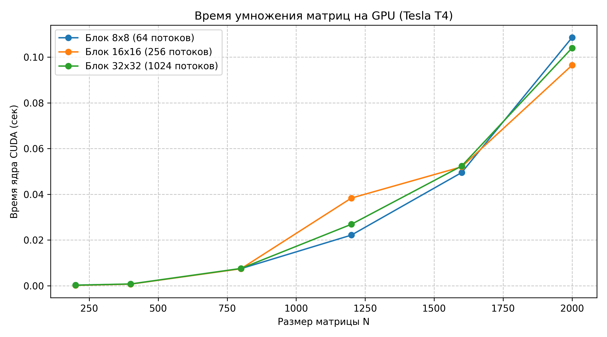
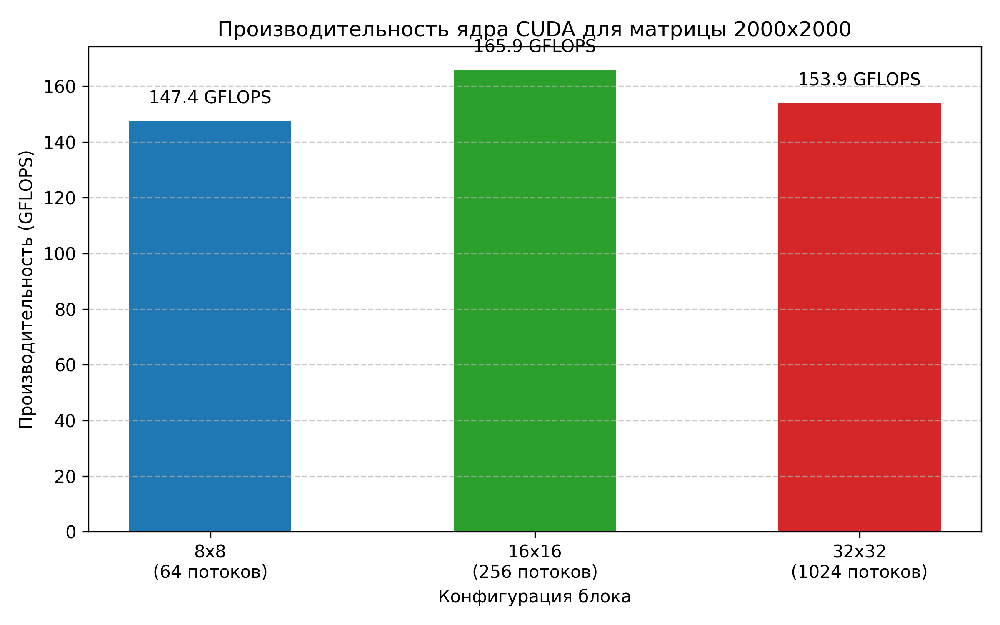

# Лабораторная работа №4: Умножение квадратных матриц на GPU с использованием технологии CUDA

## 1. Цель работы
Реализация алгоритма матричного умножения для массивно-параллельной архитектуры GPU на языке C++/CUDA. Исследование влияния геометрии двумерной сетки блоков на общую производительность вычислений при различных размерностях матриц.

## 2. Аппаратное и программное обеспечение
* **Вычислительная среда:** Google Colab
* **Графический процессор (GPU):** NVIDIA Tesla T4 (Архитектура Turing, 2560 ядер CUDA, 16 ГБ VRAM GDDR6)
* **Compute Capability:** 7.5
* **Хост-процессор (CPU):** Intel Xeon @ 2.20GHz
* **Версия CUDA Toolkit:** 12.x (компилятор `nvcc -O3 -arch=sm_75`)

## 3. Описание реализации
1. **Модель параллелизма:** Массивно-параллельная модель SIMT (Single Instruction, Multiple Threads). Каждый поток отвечает за вычисление одного результирующего элемента $C[i][j]$.
2. **Конфигурация сетки:**
   * Двумерная сетка блоков (`dim3 grid`) и двумерные блоки потоков (`dim3 block(B, B)`).
   * Исследуемые размеры блоков: $8 \times 8$ (64 потока/блок), $16 \times 16$ (256 потоков/блок), $32 \times 32$ (1024 потока/блок — аппаратный максимум блока CUDA).
   * Размер сетки динамически рассчитывается с округлением вверх:  
     $$\text{grid.x} = \lceil N / B \rceil, \quad \text{grid.y} = \lceil N / B \rceil$$
3. **Управление памятью:** Выделение памяти на GPU через `cudaMalloc`, передача исходных данных через `cudaMemcpyHostToDevice`, выгрузка результата через `cudaMemcpyDeviceToHost`.
4. **Замер времени:** Замеряется исключительно время выполнения вычислительного ядра `matrixMulKernel` с помощью аппаратных таймеров `cudaEvent_t`. Время работы шины PCIe и дискового I/O исключено.

---

## 4. Результаты экспериментов

### Таблица 1. Время работы ядра CUDA $T(N)$ в зависимости от конфигурации блока (сек)

| Размер (N) | Блок 8x8 (64 потока) | Блок 16x16 (256 потоков) | Блок 32x32 (1024 потока) |
|:----------:|:--------------------:|:------------------------:|:------------------------:|
| **200**    | 0.0003               | 0.0002                   | 0.0003                   |
| **400**    | 0.0007               | 0.0007                   | 0.0008                   |
| **800**    | 0.0075               | 0.0075                   | 0.0076                   |
| **1200**   | 0.0222               | 0.0383                   | 0.0269                   |
| **1600**   | 0.0495               | 0.0520                   | 0.0524                   |
| **2000**   | 0.1085               | **0.0964**               | 0.1040                   |

---

### Таблица 2. Производительность (GFLOPS) и сравнение с CPU для $N = 2000$

$$\text{GFLOPS} = \frac{2 \times N^3}{T \times 10^9}, \quad S_{GPU/CPU} = \frac{T_{CPU\_Serial}}{T_{GPU}}$$

| Конфигурация блока | Время ядра (сек) | Производительность (GFLOPS) | Ускорение относительно Л/Р №1 ($T_{CPU} / T_{GPU}$) |
|:------------------:|:----------------:|:---------------------------:|:---------------------------------------------------:|
| **8x8**            | 0.1085           | 147.5                       | 52.2940x                                            |
| **16x16**          | **0.0964**       | **166.0**                   | **58.8579x**                                        |
| **32x32**          | 0.1040           | 153.8                       | 54.5567x                                            |

---

## 5. Графики производительности

### Зависимость времени выполнения от размера матрицы

### Производительность конфигураций блоков (N = 2000)

---

## 6. Верификация
Выходной файл проверен скриптом `common/verify.py`. Сравнение с эталоном NumPy подтвердило численную корректность вычислений с плавающей точкой двойной точности (`double`) на всех размерах матриц и конфигурациях сетки (Статус: **OK**).

---

## 7. Выводы
1. **Абсолютная производительность:**  
   Пиковая производительность ядра достигнута на матрице $2000 \times 2000$ с конфигурацией блока **$16 \times 16$** и составила **166.0 GFLOPS** (время выполнения — **0.0964 сек**).
2. **Оптимум конфигурации блока:**  
   Конфигурация $16 \times 16$ (256 потоков на блок) превосходит $8 \times 8$ на **12.5%** и $32 \times 32$ на **7.9%** при максимальном объеме задачи ($N=2000$). Это подтверждает, что 256 потоков на блок обеспечивают наилучший баланс между задействованными регистрами и числом одновременно выполняемых активных варпов (Warp Occupancy) на SM видеокарты Tesla T4.
3. **Область системных погрешностей:**  
   На малых размерностях ($N \le 400$) время работы ядра составляет менее **1 миллисекунды** (0.0002–0.0008 сек). В этом диапазоне накладные расходы на запуск ядра со стороны CPU-драйвера превышают полезное вычислительное время GPU, а разница между конфигурациями блоков нивелируется.