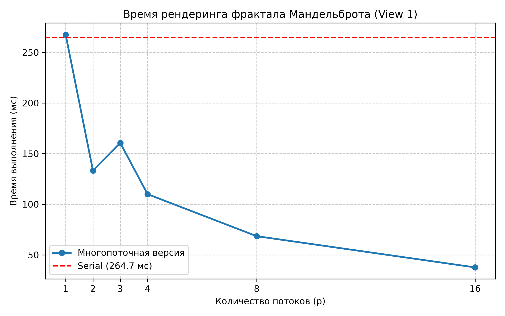
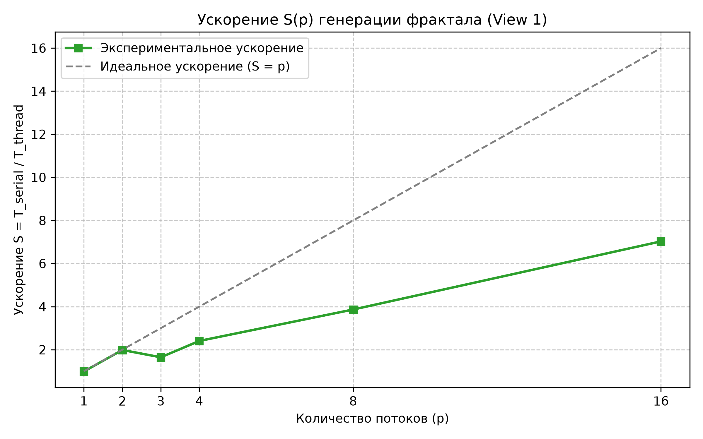

# Лабораторная работа №5 (Stanford CS149: Program 1)
# Параллельная генерация фрактала Мандельброта с использованием std::thread

## 1. Цель работы
Исследование многопоточной генерации множества Мандельброта с использованием библиотеки стандартных потоков C++ (`std::thread`). Анализ проблемы геометрического дисбаланса вычислительной нагрузки (Load Imbalance) и оценка эффективности масштабирования программы на CPU.

---

## 2. Результаты экспериментов (View 1, 1600x1200)

Последовательное время выполнения (Serial Baseline): **267.52 мс**.

### Таблица замеров

| Потоки ($p$) | Время (мс) | Ускорение $S(p)$ | Эффективность $E(p)$ |
|:------------:|:----------:|:----------------:|:--------------------:|
| **1**        | 267.521    | 0.99x            | 98.9%                |
| **2**        | 133.244    | 1.99x            | 99.3%                |
| **3**        | 160.653    | 1.65x            | 54.9%                |
| **4**        | 110.013    | 2.41x            | 60.2%                |
| **8**        | 68.492     | 3.86x            | 48.3%                |
| **16**       | 37.671     | 7.03x            | 43.9%                |

---

## 3. Графики производительности

### Время выполнения

### Ускорение относительно последовательной версии

---

## 4. Ответы на контрольные вопросы задания

### Вопрос 1. Линейно ли ускорение при блочном разделении строк?
**Ответ:** Нет, ускорение не является линейным. При переходе с 2 потоков на 3 зафиксировано резкое увеличение времени выполнения со $133.24$ мс до $160.65$ мс (падение ускорения с $1.99\times$ до $1.65\times$).

### Вопрос 2. Причина нелинейного поведения на 3 потоках (Пункты 2 и 3)
1. **Неоднородность алгоритма:** Точки вне фрактала сходятся за 1–5 итераций, точки внутри множества выполняют максимально заданное число итераций (`maxIterations = 256`).
2. **Геометрическая локализация:** В ракурсе View 1 тело фрактала сосредоточено в центральной полосе строк. При делении на 3 непрерывных блока ($1200 / 3 = 400$ строк на поток) Поток 0 (строки 0–399) и Поток 2 (строки 800–1199) обрабатывают только разреженный фон и быстро завершают работу.
3. **Простой потоков:** Поток 1 (строки 400–799) получает почти всю вычислительную массу фрактала. Поскольку барьер ожидания (`join()`) ждет завершения последнего потока, суммарное время определяется исключительно временем Потока 1, пока остальные ядра CPU простаивают.

### Вопрос 3. Масштабирование до 16 потоков (Пункт 5)
На 16 потоках достигнуто ускорение $7.03\times$ (время $37.67$ мс). Эффективность снизилась до $43.9\%$.
Основными ограничивающими факторами являются:
* Наличие физических и логических ядер (SMT): при превышении числа физических ядер потоки делят общие блоки FPU и кэш-память L1/L2.
* Сохраняющийся остаточный дисбаланс строк внутри блоков.